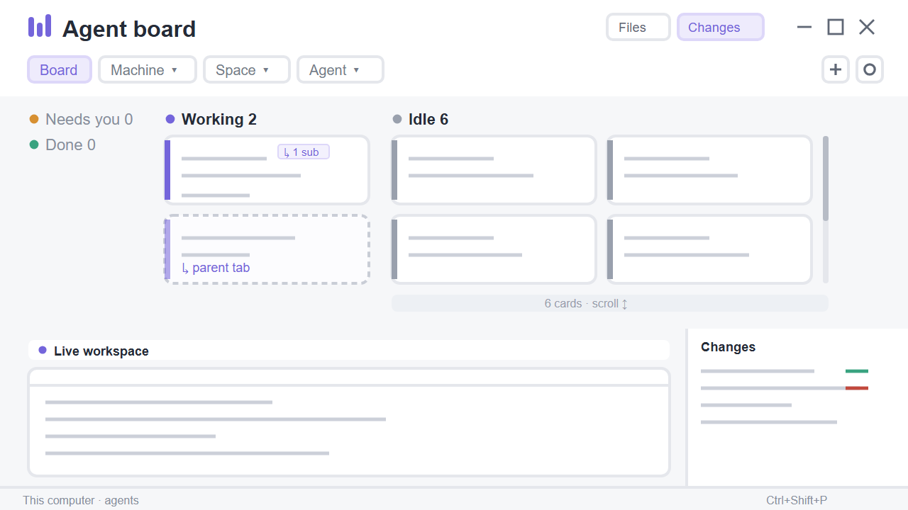

# herdr-dynamic-board

A Herdr app layout: an agent and terminal kanban board with live terminals, Files/Changes panels, a status bar and its own window buttons. See [RECIPE.md](RECIPE.md) for what it shows and how it's built.



## Install

Copy `layouts/dynamic-board.json` and the `mods/dynamic-board/` folder into the Herdr home. Leave out `RECIPE.md`, `README.md`, `preview.png` and `LICENSE`.

- Windows: `%USERPROFILE%\.config\herdr-app\`
- macOS / Linux: `~/.config/herdr-app/` (or `$HERDR_APP_HOME`)

Copy the whole mod folder at once, or `mod.json` before `main.js`, so Herdr doesn't dock the mod into the shown layout. Then:

```sh
herdr-app check ~/.config/herdr-app/mods/dynamic-board
herdr-app do layout.switch --name dynamic-board
```

You can also give an agent running inside Herdr this repository and ask it to install the layout. Herdr's AGENTS.md tells it how. If the name is already taken, rename the new one instead of overwriting.

To switch away use `ctrl-shift-l` or Settings → Look → Layout. To remove it, delete the layout file and the mod folder.

## License

A modified version of the `board` example in herdrdev/herdr-layout-examples, under the Apache License 2.0 (`LICENSE`). The changes are listed at the top of `mods/dynamic-board/main.js`.
