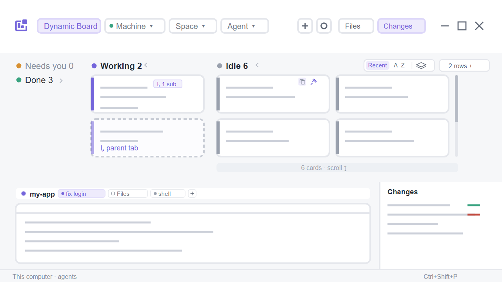

# Dynamic Board

A complete Herdr window built around a kanban board of every agent and terminal across every machine.
- Each one is a card in a status column (Needs you, Working, Done, Idle).
- Sub-agents an agent started appear as dashed cards linked to their parent.
- Chips filter the board by machine, space and type.
- A + popup creates spaces, tabs and worktrees.
- The active tab's terminals stay live underneath, with Herdr's Files and Changes panels and status bar.
- It draws its own window buttons, so it needs no other layout.

Based on the `board` example in [herdrdev/herdr-layout-examples](https://github.com/herdrdev/herdr-layout-examples) (Apache License 2.0, see `LICENSE`). Renamed to `dynamic-board` and changed as listed at the top of `mods/dynamic-board/main.js`.

## What you see

Top to bottom, light `paper` theme, the person's own fonts (settings.json; Herdr's Geist when unset), background `#f6f7f9`, accent `#7465db`:

1. **Header**: 100 px, white, drags the window.
   - **Row 1, left**: a three-bar violet logo, then the title (the filtered space or machine, else the active space), then `/ Agent board` in grey.
   - **Row 1, right**:
     - a count, e.g. "10 agents · 3 terminals across 9 spaces", or "4 of 13 shown (…)" when filtered;
     - `Files` and `Changes` buttons (27 px, violet when their panel is open);
     - minimize, maximize/restore and close (34×27 px). Close turns red on hover. On Windows they use Herdr's vector icons.
   - **Row 2**: chips `Board`, `● Machine ▾`, `Space ▾`, `Agent ▾` (27 px, violet when selected). At the right: a square `+` and a square ⚙.
   - **Connection dot**: the Machine chip's 6 px dot sums up every machine's layout state (`machines()`).
     - Red when any machine is unavailable; the tooltip reads "1 machine offline: seogang".
     - Amber while one is loading; the tooltip reads "Connecting: …".
     - Green when all are ready; the tooltip reads "All machines connected", or "This computer" with no other machine.

     The popup's own rows show each machine's state.
2. **Cards**: 284 px by default (two full card rows with the "scroll to see all" footer), bordered, four status columns. Drag its bottom edge to resize it (190–900 px). The board recounts how many rows fit, and Herdr keeps the size.
   - Column colors: Needs you `#d79032`, Working `#7465db`, Done `#39a380`, Idle `#99a0ad`.
   - An empty column folds into a 136 px strip at the far left: only its title, dot and `0`, stacked.
   - Open columns keep the card width they'd have with all four open. Room freed by folded columns becomes extra card slots, so cards flow side by side and wrap like floats. Extra slots go first to the column hiding the most cards.
   - A column with more cards than fit shows an always-visible scrollbar and a footer: "N cards · scroll to see all ↕".
3. **Card**: 86 px, white, 7 px radius, 3 px status bar at the left.
   - Line 1: program icon and name, then the terminal address (`t15`).
   - Line 2: the tab name, bold.
   - Line 3: a machine tag (monitor icon for this computer, server icon for others), the space name, and "N m observed".
   - A parent card adds `↳ N sub`, with one status dot per sub-agent.
   - A sub-agent card has a dashed `#c9cdd6` border, a faded bar, a `SUB` tag, its name on line 2, and `↳ <parent tab> (t15)` in violet on line 3.
   - A plain terminal card has a `TERMINAL` tag.
4. **Work area**:
   - On the left, the live workspace: a 34 px strip, "Live workspace · space / tab · TERMINALS". Under it, the active tab's panes as white cards (gap 12, radius 7), each with a 28 px header showing icon, name and status dot.
   - On the right, the Files / Changes panel: 368 px wide, resizable from 280 to 900, hidden until opened.
5. **Status bar**: 28 px, Herdr's `workspace-status`.

## How it behaves

- **Status mapping**: blocked → Needs you, working → Working, done → Done, idle → Idle.
  - Plain terminals report no status. A shell waiting at its prompt sits in Idle. A program running in the foreground (a build, `gh auth login`, a server) sits in Working.
  - "N m observed" counts from when the board first saw the current status. The board re-renders every 30 s.
- **Click**:
  - An agent card focuses it (`agent.focus`).
  - A terminal card focuses its pane (`pane.focus`).
  - A sub-agent card peeks at it over the tab (`terminal.peek`); `↳ parent` focuses the parent.
- **Right-click an agent or terminal card**: a menu combining Herdr's tab and space menus.
  - Rename / New / Close tab.
  - Rename space, New / Open worktree (in a git repo), Remove worktree (linked worktrees), Close space.
  - ↑ ↓ Enter Esc work in the menu.
- **Right-click a sub-agent card**: Peek; Keep as tab (`terminal.keep` with `place: "tab"`); Go to parent; Kill sub-agent…, which asks with Herdr's `confirm` dialog first.
- **Chips** open a popup just under the chip:
  - Machine, with layout state dots;
  - Space, only the chosen machine's spaces;
  - Type: each agent program plus one `Terminal` type.

  Rows show counts. `Board` clears every filter. The filter is shared as `dynamic-board.filter`. Sub-agents follow their parent's machine and space.
- **Space popup**: this is also the board's space list, standing in for Herdr's spaces sidebar. The popup is 400 px wide. Rows sit under a header per machine (monitor or server icon), and each row has:
  - a status dot and the name;
  - the git tail, showing only what's unusual: the repo when the name doesn't say it, the branch unless it's main/master or the name, `↑ahead` in green, `↓behind` in red and `±changes` in amber;
  - the card count;
  - a `›` button that makes it the active space (`space.select`); the current space shows a check.

  Worktree spaces sit under their repository's main checkout (`├` / `└` and a branch icon). Clicking a row filters. Right-clicking a row opens the space menu alone: Rename, New / Open / Remove worktree, Close.

  Git is read when the popup opens, for the spaces in scope, on each space's machine. Meanwhile the last answers show from the shared cache `dynamic-board.git`, with `git…` in the title. A machine that can't be reached keeps its cached answer.

  Past ten rows, the list keeps an always-visible scrollbar.
- **Add machine**: the Machine popup ends with a divider and `+ Add machine…` (violet). It opens Herdr's Add machine dialog (`mod.open machine-add`), as the default sidebar does. The dialog lists ssh-config hosts with Add / Added and takes `user@host`. A machine it adds appears in the Machine popup once connected.
- **Machine order**: the ⚙ button in the Machine popup's title row opens the Machine order popup (320 px). It lists one row per machine (`⠿`, monitor or server icon tinted by layout state, name, space count).
  - Drag a row onto another to move it there.
  - `A–Z` sorts machines by name. `Default` goes back to Herdr's order: this computer first, then by name.
  - Herdr itself has no machine order to change, so this order is the board's own. It is shared as `dynamic-board.machines`; machines it doesn't name yet follow in Herdr's order.
  - The order is used everywhere the board lists machines: the Machine popup, the machine headers of the Space and Space order popups, the Create popup, and the cards, which follow machine order and then Herdr's space order within a machine.
- **Space order**: the ⚙ button in the Space popup's title row opens the Space order popup (320 px). It reads git for every space when it opens.
  - Spaces are grouped by machine. Worktree spaces are indented under their repository's main space (`├` / `└`, branch icon), as in the Space popup.
  - **Drag rules** (`⠿`, then `space.move`):
    - A top-level space moves as a block with its worktrees. It can be dropped only on another top-level space; dragging down lands it after that space's whole block.
    - A worktree space can be dropped only on a sibling under the same main space.
    - Other drops are refused: no violet line, nothing moves.
  - **Writing the order**: the result is written as one full order for the machine. Worktrees follow their main space in the real order too, so the order shown is the order kept.
  - Each machine header has an `A–Z` button. It sorts top-level spaces by name, then each one's worktrees by name.
  - Spaces only move within their machine, as in Herdr.
- **`+`** opens Create, right-aligned under the button:
  - Mode: New space / New tab / Worktree.
  - Machine, then Space for tab and worktree modes.
  - Worktree mode: New worktree (branch) or Open worktree…, both through Herdr's `worktree` dialog.
  - Start: Terminal or any `knownAgents` agent, installed first, then "Show N more (not installed)".
  - Names are left to Herdr's defaults; an agent tab is named after the agent.
- **⚙** opens `app.settings`.
- **Files / Changes** select that child of the `panel-body` stack and show `panel`. Pressing the open one hides it. Which buttons appear follows shared `workspace.panels`, else both.
- **Per-space panel**: the panel is remembered per space, as in Herdr's tab bar. Switching to a space restores what it last showed (none, Files or Changes), closed if it never had one. The header copy keeps this in its `localStorage`, so it survives restarts.
- **Window buttons** run `window.minimize`, `window.maximize` (or restore) and `window.close`. They are drawn only when `window().buttons` says the system draws none.
- `agent.next` / `agent.prev` follow the board's order, for paned agents only.

## Built from

- **`layouts/dynamic-board.json`**: a root column (`titlebar: none`, `paper`, preview `mods/dynamic-board/preview.svg`). Its children, top to bottom:
  - `board-header`: `{mod: "dynamic-board", props: {role: "header"}}`.
  - `board-split`, a resizable column with a divider, so the board's height can be dragged:
    - `board-cards`: `{mod: "dynamic-board"}`, 284 px (min 190, max 900);
    - `work-body` (min 160), a resizable row with a divider, containing:
      - the `workspace` column: the `workspace-title` block (`role: "terminals"`) and `{tab: "active"}` with pane headers (`role: "pane"`);
      - the hidden `panel` column: a stack `panel-body` with the `files` and `changes` blocks.
  - `status`: `{mod: "workspace-status"}`.
- **`mods/dynamic-board/main.js`**: one mod with several roles.
  - Block roles: `header`, the default board, `terminals`, `pane`.
  - Popup roles opened with `openOverlay`: `pick`, `menu` (`spaceOnly` for the space menu alone), `create`, `order` (spaces), `morder` (machines).
- **Herdr data**: `agents()`, `terminals()` (sub-agents: `parent`, `state`, `name`), `panes()` (plain terminals: no `status`), `spaces()`, `machines()`, `layout()`, `window()`, `knownAgents({on})`, `shared` / `setShared`, `setAgentOrder`, `keys()`.
- **Commands**:
  - focus and terminals: `agent.focus`, `pane.focus`, `terminal.peek`, `terminal.keep`, `terminal.kill`;
  - tabs and spaces: `tab.new|rename|close`, `space.new|rename|close`;
  - layout: `layout.select|show|hide`;
  - window and app: `window.minimize|maximize|close`, `app.settings`.
- **Shipped pieces used**:
  - mods `files`, `changes`, `workspace-status`, `worktree`, `confirm`, `machine-add`;
  - icons in `mods/workspace-chrome/`, `mods/tabs/win-*.svg`, `mods/files/file.svg`, `mods/changes/changes.svg`, `icons/shell.svg`;
  - the `new-menu.agents` shared cache.
- **Runs programs**: through `exec`, in a space's folder on that space's machine:
  - `git rev-parse --show-toplevel` and `--git-common-dir`, to tell whether the worktree items apply and to nest worktrees;
  - `git --no-optional-locks -c core.fsmonitor=false status --porcelain=v2 --branch` when the Space popup opens, for branch, ahead/behind and changes. It writes nothing to the repo. The shipped Files and Changes panels read and change files and git state in the active space as they do in Herdr's default window. The board itself has no network access and reads no files.

## Watch out

- **Popups**: popups collapse with `size_full` / `flex_1`. Use `w_full` and fixed list heights, and pass `width`/`height` to `openOverlay`. `herdr-app check` doesn't render popup roles, so test them on screen.
- **Colors**: colors must be hex or theme names. Use `#ffffff00`, not `transparent`.
- **Fonts**: leave `font`, `font_size` and `ui_font` off the layout root. A layout's own font beats settings.json, so setting one locks Settings → Interface font and the terminal font.
- **Measuring size**: measure with `on_size_change` on the root only. The first frame uses flexible columns until the size arrives.
- **Popup anchors**: anchor popups at `position − local_position` from `on_mouse_down`.
- **Where the data comes from**:
  - `agents()` lists paned agents only.
  - Sub-agents come from `terminals()` with `parent`.
  - Plain terminals come from `panes()` entries with a `terminal` and no `status`.
  - Remote addresses are machine-qualified (`vps/t17`) everywhere, so they match.
- **Layout names**: letters, digits and hyphens only. A name with parentheses or spaces is silently ignored by `layout.switch`.
- **Mod setup**: write `mod.json` (`{"place":"none"}`) before `main.js`. Otherwise Herdr docks the mod into the shown layout.
- **Panel ids**: the Files/Changes buttons look for the ids `panel` and `panel-body`. Keep them if you restructure the layout.
- **Testing popups**: popup copies don't receive `<mod>.<command>`, and `overlay.close` without the right id leaves popups open.
  - To drive one in a test, pass state through `shared` and close it with the id `openOverlay` returned.
  - `fs.readFile` resolves relative paths from the user's home, not the Herdr home; use `appHome()`.

## Done when

- `herdr-app check <home>/mods/dynamic-board` passes, and `herdr-app status` shows no errors on `dynamic-board`.
- **Columns**: empty status columns appear only as stacked titles at the left. A full column shows a scrollbar and the "N cards" footer before any scrolling.
- **Filters**: picking a machine narrows the Space popup to it. The Type popup lists a `Terminal` row.
- **New terminal**: opening a new terminal adds a `TERMINAL` card. Running a command in it moves the card to Working.
- **Sub-agents**: a terminal started by an agent with `hc run` appears as a dashed card, and its parent shows `↳ 1 sub`.
- **Panels**: `Changes` opens the panel on the right with the active space's git changes. Pressing it again hides the panel.
- **Per-space panel**: open Changes in one space, switch to another (closed), open Files there, then go back: Changes is open again. Return to the second space and Files is open.
- **Space popup**: rows show branch/↑↓/± for git spaces, also on other machines. A worktree space appears under its repository. `›` switches the Live workspace to that space without changing the filter.
- **Add machine**: `+ Add machine…` in the Machine popup closes it and opens Herdr's Add machine dialog with the ssh-config hosts.
- **Connection dot**: with every machine connected the Machine chip's dot is green, and its tooltip reads "All machines connected". When a remote machine is unreachable the dot turns red, and the tooltip names the machine.
- **Machine order**: setting wsl2 → this computer → seogang reorders:
  - the Machine popup;
  - the Machine order popup;
  - the Space popup's machine headers;
  - the cards (wsl2's first in every column).

  `Default` restores this computer first.
- **Space order**: dragging a space onto another in the Space order popup moves it in the order everywhere (Space popup, cards' space order). `A–Z` sorts one machine.
- **Worktree rules**: with a repo space and three worktree spaces created in mixed order:
  - The popup shows the worktrees under the repo space.
  - A worktree moves only among its siblings; dropping it on another space does nothing.
  - Moving the repo space carries its worktrees.
  - `A–Z` gives `repo > wt-a > wt-b > wt-c > other`.
- **Window buttons**: on Windows and Linux, minimize, maximize/restore and close act on the window.
