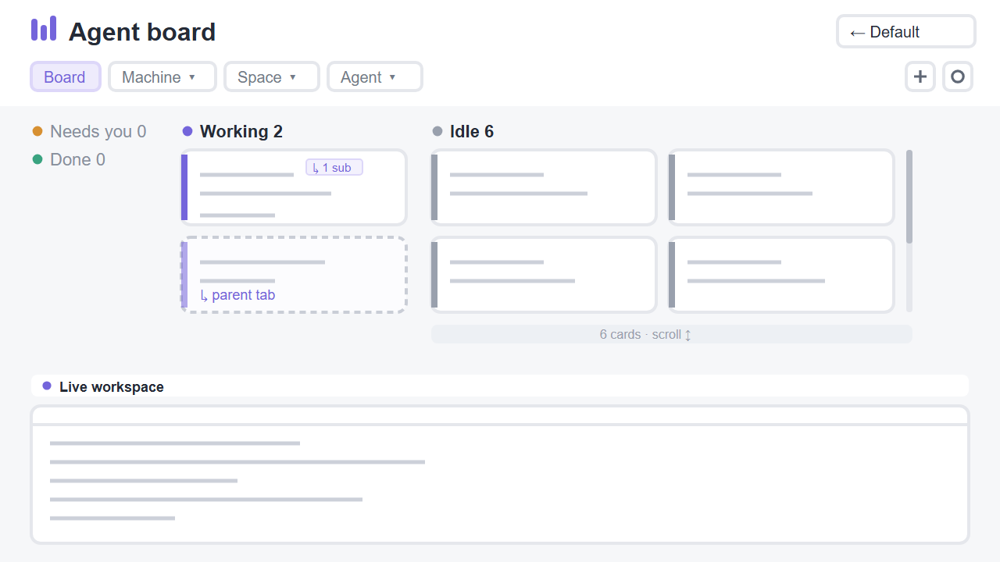

# Board-isitea

A kanban board of every agent across every machine. Each agent is a card in a status column (Needs you, Working, Done, Idle); sub-agents an agent started appear as their own dashed cards, linked to their parent. Chips filter the board by machine, space and agent type, a + popup creates spaces, tabs and worktrees, and the active tab's terminals stay live underneath.

Based on the `board` example in [herdrdev/herdr-layout-examples](https://github.com/herdrdev/herdr-layout-examples) (Apache License 2.0, see `LICENSE`), renamed to `board-isitea` and changed as listed at the top of `mods/board-isitea/main.js`.

## What you see

Top to bottom, light `paper` theme, Geist 13, background `#f6f7f9`, accent `#7465db`:

1. **Header** (100 px, white, drags the window).
   - **Row 1**: a three-bar violet logo, then the title. The title is the filtered space or machine, else the active space. Then `/ Agent board` in grey. At the right: a count ("10 agents across 9 spaces", or "2 of 10 agents" when filtered) and a `← Default layout` button.
   - **Row 2**: chips `Board`, `Machine ▾`, `Space ▾`, `Agent ▾` (27 px tall, violet when selected). At the right: `● Live updates`, a square `+` button, then a square ⚙ button.
2. **Cards** (355 px, bordered). This is the four status columns:
   - Needs you `#d79032`, Working `#7465db`, Done `#39a380`, Idle `#99a0ad`.
   - **Empty columns**: an empty column folds into a 136 px strip at the far left. Only its title, dot and `0` show, stacked.
   - **Open columns**: open columns keep the card width they'd have with all four open. Room freed by folded columns becomes extra card slots, so a column's cards flow side by side and wrap like floats. Extra slots go first to the column hiding the most cards.
   - **Overflow**: a column with more cards than fit shows an always-visible scrollbar and a footer, "N cards · scroll to see all ↕".
3. **Card** (86 px, white, 7 px radius, 3 px status bar at the left).
   - **Line 1**: program icon and name, then the terminal address (`t15`).
   - **Line 2**: the tab name, bold.
   - **Line 3**: a machine tag (monitor icon for this computer, server icon for others), the space name, and "N m observed".
   - **Parent card**: a parent card also shows `↳ N sub` with one status dot per sub-agent.
   - **Sub-agent card**:
     - dashed `#c9cdd6` border, a faded status bar and a `SUB` tag;
     - its name on line 2;
     - `↳ <parent tab> (t15)` in violet on line 3.
4. **Live workspace**: a 34 px white strip ("Live workspace · space / tab · TERMINALS"). Below it, the active tab's panes as white cards (gap 12, radius 7), each with a 28 px header showing program icon, name and status dot.

## How it behaves

- **Status**: blocked → Needs you, working → Working, done → Done, idle → Idle. "N m observed" counts from when this board first saw the current status. The board re-renders every 30 s for that.
- **Click a card**:
  - an agent card focuses that agent (`agent.focus`);
  - a sub-agent card peeks at it over the tab (`terminal.peek`), since it has no pane;
  - `↳ parent` on a sub-agent card focuses the parent.
- **Right-click an agent card** for a menu combining Herdr's tab and space menus:
  - Rename / New / Close tab;
  - Rename space, New / Open worktree (only in a git repo), Remove worktree (linked worktrees only), Close space.
  - Keyboard: ↑ ↓ Enter Esc.
- **Right-click a sub-agent card** for Peek, Keep as tab (`terminal.keep` `place: "tab"`), Go to parent, and Kill sub-agent…. Kill opens Herdr's `confirm` dialog before `terminal.kill`.
- **Chips** open a popup just under the chip. The popups are:
  - Machine: with layout state dots;
  - Space: only the chosen machine's spaces;
  - Agent type.
  - Each row shows how many agents it holds. `Board` clears all filters.
  - The filter is shared as `board.filter`. Sub-agents follow their parent's machine and space.
- **`+`** opens a Create popup, right-aligned under the button.
  - Mode: New space / New tab / Worktree. Pick a Machine, then (tab/worktree) a Space.
  - Worktree mode: New worktree with a branch, or Open worktree…, which opens Herdr's `worktree` dialog.
  - Start: Terminal or any agent from `knownAgents` (installed first, "Show N more (not installed)").
  - Names are left to Herdr's defaults; an agent tab is named after the agent.
- **⚙** opens `app.settings`. **← Default layout** switches to `Herdr-isitea` if present, else `main`.
- Agent navigation (`agent.next` / `agent.prev`) follows the board's order, paned agents only.

## Built from

- **`layouts/Board-isitea.json`**: a root column (`titlebar: none`, `paper`, preview `mods/board-isitea/preview.svg`) containing:
  - `board-header` block: `{mod: "board-isitea", props: {role: "header"}}`;
  - `board-cards` block: `{mod: "board-isitea"}`;
  - `workspace` column: the `workspace-title` block (`role: "terminals"`) and `{tab: "active"}` with pane headers `role: "pane"`.
- **`mods/board-isitea/main.js`**: one mod, many roles. The block roles are `header`, the default board, `terminals` and `pane`. The popup roles, opened with `openOverlay`, are `pick`, `menu` and `create`.
- **Herdr data**:
  - `agents()`, `terminals()` (sub-agents: `parent`, `state`, `name`), `spaces()`, `machines()`, `panes()`;
  - `knownAgents({on})`, `shared` / `setShared`, `setAgentOrder`, `layouts()`, `keys()`.
- **Commands**:
  - `agent.focus`, `terminal.peek`, `terminal.keep`, `terminal.kill`;
  - `tab.new|rename|close`, `space.new|rename|close`;
  - `layout.switch`, `app.settings`.
- **Uses shipped pieces**:
  - the `worktree` and `confirm` mods;
  - icons from `mods/workspace-chrome/*.svg` and `icons/shell.svg`;
  - the `new-menu.agents` shared cache.
- **Runs programs**: `git rev-parse --show-toplevel` and `--git-common-dir`, via `exec`, in a space's folder on that space's machine. These calls tell whether the worktree items apply. No network access; reads no files.

## Watch out

- **Popup sizing**: popups collapse with `size_full` / `flex_1`. Use `w_full` and fixed list heights, and pass `width`/`height` to `openOverlay`. `herdr-app check` doesn't render popup roles, so test them on screen.
- **Colors**: colors must be hex or theme names. Write `#ffffff00`, not `transparent`.
- **Sizing data**: measure with `on_size_change` on the root only. Column widths come from it, so the first frame uses flexible columns.
- **Popup anchoring**: anchor popups with `position − local_position` from `on_mouse_down`. Clicks give no element bounds.
- **Sub-agents**: `agents()` lists paned agents only; sub-agents come from `terminals()` with `parent`. Remote addresses are machine-qualified (`vps/t17`) in both, so they match.
- **Mod placement**: write `mod.json` (`{"place":"none"}`) before `main.js`. Otherwise Herdr docks the mod into the shown layout.
- **Linked layout**: the `← Default layout` button expects the companion `Herdr-isitea` layout and falls back to `main`.

## Done when

- `herdr-app check <home>/mods/board-isitea` passes and `herdr-app status` shows no errors on `Board-isitea`.
- Empty status columns appear only as stacked titles at the left. A column with more agents than fit shows a scrollbar and the "N cards" footer before any scrolling.
- Picking a machine narrows the Space popup to that machine. The count reads "N of M agents".
- Right-clicking a card opens the tab + space menu; Rename tab asks for a name.
- A terminal started by an agent with `hc run` appears as a dashed card in its status column. Its parent card shows `↳ 1 sub`.
- `+` → New tab → a space → Claude → Create opens a tab named "Claude Code" running it.
