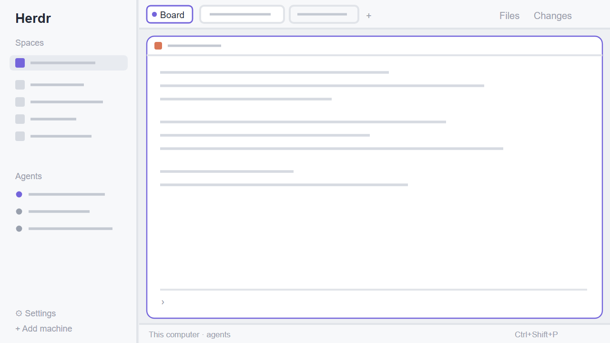

# Herdr-isitea

Herdr's default window (spaces and agents on the left, tab pills on top, panes as cards, Files/Changes panels, a status bar) with one addition: a `Board` button at the start of the tab bar that switches to the Board-isitea layout.

## What you see

Left to right. There is no look of its own: settings.json and the theme picker decide it, as for Herdr's `main`.

1. **Sidebar** (268 px, `chrome` background):
   - the `workspace-chrome` brand bar (46 px);
   - the `spaces` and `agents` lists, sharing the height evenly (min 90 px each);
   - the `workspace-chrome` footer (69 px) with Settings and Add machine.
2. **Work column**:
   - **Top bar** (42 px). It holds an 84 px block with the **Board** button, then the shipped `tabs` bar (drags the window). The button is 26 px tall with rounded corners, a `surface` background, a `border` outline, an accent dot and the label "Board". On hover it gets the `hover` background and an `accent` outline.
   - **Body** (padding 8, gap 8): the active tab's panes as cards. Each card has a 30 px `pane` header, `border` border, `accent` focus, radius 10 and gap 8, and is framed even when alone. On the right is a hidden 368 px panel stack with `files` and `changes`.
   - **Status bar** (28 px): `workspace-status`.

## How it behaves

- **Board** button: `layout.switch {name: "Board-isitea"}`. If that layout isn't installed, the label turns `dim` and clicking does nothing.
- Everything else is Herdr's `main`: same mods, same keys, same panels.

## Built from

- `layouts/Herdr-isitea.json`: a clone of Herdr's `main` (`cloned_from: main 0.1.13`), with two changes:
  - the `tabs` block is wrapped in a `topbar` row with a `to-board` block first, containing `{mod: "layout-switch-isitea", props: {to: "Board-isitea", label: "Board"}}`;
  - root `"preview": "layouts/Herdr-isitea.svg"`.
- `mods/layout-switch-isitea/main.js`: a small button.
  - `props().to` (default `Board-isitea`) and `props().label`;
  - `layouts()` to know if the target exists, and `run("layout.switch", {name})`;
  - it stops the mouse press, so the `window_drag` doesn't swallow the click.
- Shipped mods used: `workspace-chrome`, `spaces`, `agents`, `tabs`, `pane`, `files`, `changes`, `workspace-status`.
- No programs run, no network, no files read.

## Watch out

- **Layout names**: they may use letters, digits and hyphens. A name with parentheses or spaces (`Board(isitea)`) is silently ignored by `layout.switch`.
- **Mod placement**: write `mod.json` (`{"place":"none"}`) before `main.js`. Otherwise Herdr docks the button into the shown layout on its own.
- **Updates**: a cloned layout isn't updated with Herdr. Compare with a new `main` after Herdr updates.
- **Companion layout**: install with Board-isitea; without it the Board button is inert.

## Done when

- `herdr-app check <home>/mods/layout-switch-isitea` passes.
- `herdr-app do layout.switch --name Herdr-isitea` shows the default window with a `Board` button before the tabs.
- Clicking `Board` switches to Board-isitea, and Board-isitea's `← Default layout` comes back.
- Settings → Look → Layout shows the Herdr-isitea preview drawing.
